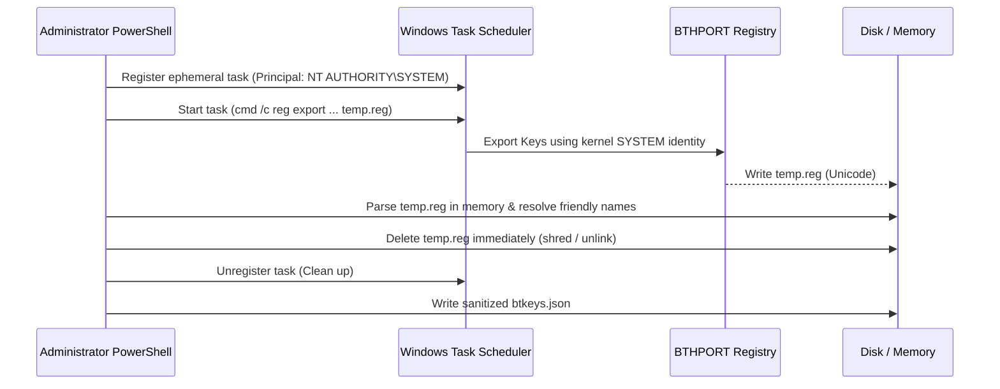

# Explanation: Windows Kernel Security & Ephemeral SYSTEM Isolation 🛡️

This document explains the security architecture of Windows Bluetooth key storage and how `Export-BluetoothKeys.ps1` extracts keys securely without external tools.

---

## 1. The Access Control Problem

Windows stores Bluetooth configurations under:
`HKEY_LOCAL_MACHINE\SYSTEM\CurrentControlSet\Services\BTHPORT\Parameters`

Within this tree:
- `Devices/` contains human-readable metadata (readable by Administrators).
- `Keys/` contains the raw 128-bit pairing secrets.

By default, the Windows Security Descriptor for `Keys/` assigns **Read / Write permissions exclusively to `NT AUTHORITY\SYSTEM`**. Even an elevated Administrator or the `BUILTIN\Administrators` group receives an `Access Denied (0x05)` error when attempting to query or export this subkey directly.

---

## 2. Traditional Workarounds & Their Flaws

1. **PsExec (`psexec.exe -s`)**:
   - *Risk*: Requires downloading external Sysinternals binaries. Triggers antivirus heuristics and enterprise EDR flags.
2. **Third-Party Closed-Source Executables**:
   - *Risk*: Running untrusted binary executables with SYSTEM privileges on a dual-boot machine presents severe supply-chain risks.
3. **Mounting Hive from Linux (`chntpw`)**:
   - *Risk*: Writing to an offline Windows NTFS registry hive can lead to `SYSTEM_PTE_MISUSE` or Blue Screens of Death (BSOD) if the NTFS volume was not cleanly unmounted (Windows Fast Startup / hibernation).

---

## 3. The Ephemeral Scheduled Task Strategy

BT-DualBoot Tools achieves clean SYSTEM execution using native Windows Task Scheduler APIs:

### Zero-Residual Guarantee:
All cleanup operations are encapsulated in a strict `try ... finally` block. Even if the registry parsing fails or the user aborts execution, the ephemeral task is destroyed and the temporary file is unlinked.
